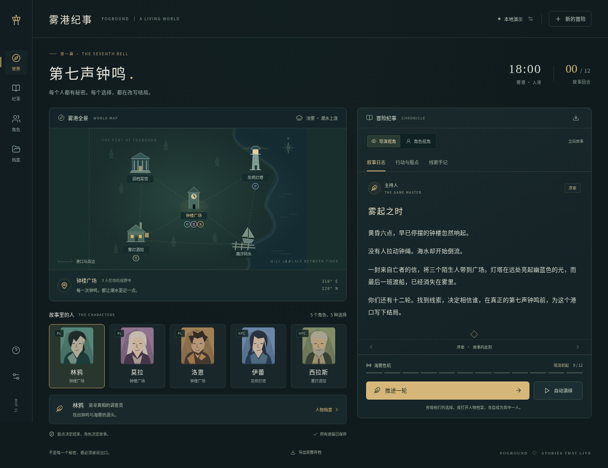

# 雾港纪事 · FOGBOUND

一个可以旁观、也可以亲自加入的多角色 Agent 跑团 MVP。五个角色分别依据自己的人物卡、目标、私有记忆和已知线索行动，在同一个世界中推进故事；GM 把规则层已经裁决的事件写成叙事。

原创短篇战役 **《第七声钟鸣》**：雾港的海水正在倒流。三个冒险者、守塔人与酒馆主各自藏着秘密。十二轮内，他们需要发现并交换证据，决定相信谁，在灯塔完成封印。



## 立即运行

需要 **Node.js 22.13+** 和 npm。本项目已在 Ubuntu WSL、Node.js 22.23.2 下验证。

```bash
npm ci
npm run dev
```

打开 **http://localhost:5173/**。Vite 与 API 都绑定本机回环地址；默认 API 端口为 `8787`。WSL 开发时，可以直接在 Windows 浏览器打开该地址。

**无需密钥即可试玩。** 默认的「本地演示」用可解释的角色策略推进故事；它不是语言模型生成的决策。

构建后以单个服务运行：

```bash
npm run build
npm start
```

此时打开 **http://localhost:8787/**。`npm start` 需要保留服务端 TypeScript 源码和 `tsx` 依赖，不是仅托管 `dist/`。

## 怎么玩

1. 点击「推进一轮」，五个角色根据同一份世界快照分别选择行动，再按敏捷执行。也可以「自动演绎」，随时暂停。
2. 点击地图地点查看场景，点击人物卡选中角色，再打开人物档案，查看人物设定、目标、秘密、关系和记忆。
3. 切换「导演视角 / 角色视角」。导演能看全局；角色只能看自己的线索、私有记忆和被其目击的事件，其他地点的人物位置显示为视野之外。
4. 在人物档案中「接管角色」，选择行动、目标和可选台词。其他四名角色仍独立决策。点击「交还角色」即可继续旁观。
5. 调查档案馆、酒馆、码头或灯塔获取线索。**发现线索不会自动广播**；分享给同地点的角色，才会转移其知识。
6. 让一名角色亲自掌握至少三条线索，抵达灯塔，通过意志检定完成封印。危机达到十二或第十二轮仍未成功，故事进入失败结局。

「行动与骰点」可查看真实检定。「上一轮 / 下一轮」回看历史日志；地图与人物卡始终表示当前状态。每轮自动保存；「档案」可以新建、切换或导入战役。

## 角色与独立性

| 角色 | 身份 | 本地行为倾向 |
| --- | --- | --- |
| 林鸦 | PL · 调查员 | 寻找证据、拼合线索 |
| 莫拉 | PL · 医师 | 保护同伴、安抚失去理智的人 |
| 洛恩 | PL · 游荡者 | 优先寻找黑盐清单、权衡利益 |
| 伊蕾 | NPC · 守塔人 | 守在灯塔、谨慎建立信任 |
| 西拉斯 | NPC · 酒馆主 | 主动联结、传递警告 |

每个角色有独立的人格、背景、公开目标、个人目标、秘密、属性、理智、线索集合、到访地点、近期记忆和信任关系。NPC 和 PL 使用相同的观察与行动循环，NPC 也会主动移动或发起互动。

**独立指决策上下文独立，不要求使用不同模型或不同进程。** 服务器先为每个人过滤观察，再分别调用角色策略或语言模型。角色拿不到其他人的秘密、个人目标、私有记忆和线索集合，也不会读取上一轮导演的全知叙事。本地策略与模型策略收到相同的观察结构。

导演模式下，GM 可以看到本轮全部已裁决事件。角色模式下，服务器直接使用可见事件生成该视角的日志，避免把全知 GM 文本中的秘密传给角色。

## 接入语言模型

打开右上角「本地演示」或左侧「模型设置」，选择「连接语言模型」，填写：

- API 地址：兼容 Chat Completions 的服务根路径，例如 `https://your-provider.example/v1`。也接受完整的 `/chat/completions` 地址。
- 模型名称：服务商的实际模型 ID。
- API Key：服务商密钥。本地模型服务不校验密钥时，可填写非空占位值。

服务应支持 `POST /chat/completions`、`messages` 和 `max_tokens`，在 `choices[0].message.content` 中返回遵循指令的 JSON。角色返回结构化行动，GM 返回叙事；MVP 没有接入 tools/function-calling 或 Responses 协议。

也可以复制 `.env.example` 为 `.env`，配置后启动：

```dotenv
LLM_BASE_URL=https://your-provider.example/v1
LLM_MODEL=your-model-id
LLM_API_KEY=your-key
```

首次未保存设置时，存在 `LLM_API_KEY` 会默认启用模型模式；之后通过界面保存的设置优先。修改 `.env` 需重启服务。

通常每轮 **五次角色请求并行，随后一次 GM 请求**；接管一名角色时少一次。每次 HTTP 请求超时为 45 秒。提供商失败、格式错误或主持人失败时，整轮不写入，界面显示错误，可用原版本重试；不会悄悄切换到本地演示。

密钥保存在本机服务端 SQLite 设置中，不加密；数据库权限设为当前用户可读写。设置查询只返回「是否已保存」，战役备份和战报不包含密钥。

**验证范围：已用本地模拟 HTTP 服务跑通五角色 + GM 的完整请求、上下文隔离与失败回滚；尚未使用真实服务商密钥验证生成质量、延迟或费用。**

## 简化规则

- 检定：`d20 + 对应属性 ≥ DC`，骰点由服务端 `crypto.randomInt` 产生。
- 调查：调查属性，按地点 DC 11–13；失败理智 −1。
- 交谈：交涉属性，信任会降低难度；成功提高双方信任。
- 分享：仅能向同地点的人分享自己已经掌握的线索，作为双方私有事件记录。
- 安抚：意志 DC 10，成功为对方恢复 4 点理智，失败恢复 1 点。
- 休整：酒馆恢复 4 点理智，其他地点恢复 2 点，同时恢复 1 HP，均不超过上限。
- 封印：灯塔、本人至少三条线索、意志 DC 12。失败理智 −3，额外危机 +1。
- 每个仍在继续的回合结束时危机 +1；危机满十二或十二轮用尽即失败。

同轮决策基于行动前快照，但执行时重新检查条件。敏捷更高的目标已经离开场景时，交谈或分享可能被中断，事件中会说明原因。

## 存档与导出

- 默认数据：`.data/fogbound.sqlite`，支持用 `DATA_DIR` 改变目录。保存设置和多个独立战役，浏览器仅记住当前战役与视角。
- Markdown 战报：右上角纪事下载按钮，按当前视角过滤。
- 完整 JSON 备份：页面底部「导出完整存档」，包含所有角色的秘密和历史；导入会创建新 ID 的副本，保留原存档。
- 持久化：角色决策、规则执行、GM 叙事全部成功后才提交。单战役执行锁与版本号检查避免重复推进覆盖存档。

这是**本机单用户的导演工具**。角色信息过滤用于角色扮演与模型上下文隔离；界面允许主动切换任何角色或导演视角，API 没有账户和访问控制。

## 代码结构

```text
shared/types.ts         结构化行动、人物与世界类型
shared/scenario.ts      原创战役、地图、线索与五张人物卡
server/engine.ts        观察过滤、动作合法性、骰点裁决、视角投影
server/agents.ts        本地角色策略与兼容模型 HTTP 适配器
server/app.ts           API、并发协调、回合进度流与失败处理
server/store.ts         SQLite 持久化和乐观版本检查
server/backup.ts        备份导入校验
src/App.tsx             世界 UI、视角切换、自动演绎与真人接管
src/components/        SVG 地图与肖像、人物卡、设置、档案和行动表单
tests/                  引擎、存储、API、模型适配及浏览器测试
docs/research/          同类项目与论文的一手来源调研
```

更详细的回合流程、信息边界及验证说明见 [MVP 架构](docs/mvp-architecture.md)。技术栈为 React 19、Vite、TypeScript、Express、Zod 和 Node 原生 SQLite，没有引入 Agent 编排框架。

## 验证

```bash
npm test          # 20 项引擎、存储、API 和模拟模型 HTTP 测试
npm run build     # TypeScript 检查与 Vite 生产构建
npm run test:e2e  # 7 项 Chromium 浏览器测试，需先 build
```

若未安装浏览器，运行 `npx playwright install chromium`，或用 `PLAYWRIGHT_CHROMIUM_EXECUTABLE` 指定现有 Chromium。配置会优先复用已安装的匹配浏览器，并兼容 Ubuntu 的 Playwright 缓存。

浏览器测试启动独立的 `8790` 端口服务，使用临时目录中的 SQLite，不触碰试玩存档。覆盖桌面和 375px 手机操作、秘密过滤、编辑与接管、自动演绎及暂停、结局、回放、刷新、下载、导入与错误恢复。测试报告在 `playwright-report/`，截图在 `test-results/`。

## 当前范围与调研

MVP 实现的是单个短篇、五个角色、五个地点与有限的结构化行动。它使用**受跑团启发的简化 d20 规则**，尚未实现完整 D&D 5E / CoC7、战斗系统、任意模组导入、多人联机、无限世界、长期向量记忆或角色反思规划。GM 的职责是叙事，世界与规则裁决由代码掌握。

[完整调研报告](docs/research/ai-trpg-multi-agent-projects-2026-10-16.md) 比较了 Concordia、ai-dnd-research、agentic_dnd、AI for TRPG、Generative Agents / AI Town 和 COC Keeper 等项目，并区分角色自治、职能协作、实际实现与计划功能。当前实现借鉴观察过滤、独立行动和统一裁决的架构思想，代码、战役和 SVG 素材均为本项目编写；没有复制未授权项目的源码。

本仓库沿用根目录 [MIT License](LICENSE)。
