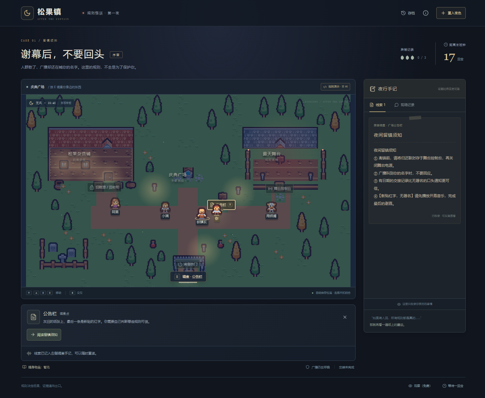

# 松果世界 · 项目入口

当前像素角色扮演版本已独立收敛到 **[roleplay-town/](roleplay-town/README.md)**，后续这版的开发、安装与配置都在该目录进行。

| 目录 | 内容 | 启动 |
| --- | --- | --- |
| `roleplay-town/` | 新版：Phaser 像素角色扮演、多 Agent 运行时、LLM 居民 | 进入该目录运行 `start.bat`，或 `npm ci` → `npm run build` → `npm start`；默认8011 |
| `backend/` + `frontend/` | 旧版：Python / React 规则怪谈游戏 | 根目录 `start.bat` / `start.ps1`；默认8000 |

新版的素材、依赖清单、模型配置、技术文档都在 `roleplay-town/` 内，已解除对旧版素材目录的运行依赖。原模型配置迁入 `roleplay-town/.env.runtime`，仍被 Git 忽略。旧版代码与本地资料保留。

```powershell
cd roleplay-town
npm ci
npm run build
npm start
```

打开 **http://127.0.0.1:8011**。下面保留旧版说明。

---

# 松果镇 · 谢幕后，不要回头

上手体验更新：草地已可自由行走，居民会巡走、做日常事务并对事件反应；首次进入有简短背景介绍和新手引导，正文默认加大，右上角 A+ 可进一步调大。详见 [LIVING_TOWN.md](docs/LIVING_TOWN.md)。

当前游戏画面已铺满窗口，地图扩大到 768×480，加入东侧步道与南侧庭院；对话、密码和手记均在画面内。按 J 查看手记，详见 [扩图与界面说明](docs/IMMERSIVE_MAP.md)。

此游戏前端已接入 Phaser 4.2.1：WebGL 像素世界、独立光效合成、手机镜头与 HTML/CSS 操作界面。启动仍使用 `start.bat` 和 8000 端口，详见 [Phaser 前端说明](docs/PHASER_FRONTEND.md)。

一个像素风规则怪谈解谜原型。庆典散场，广播仍在呼唤你的名字。按 WASD 探索广场、杂货铺和舞台，调查被篡改的规则，推导密码，完成交接并离镇。NPC 有各自的目标和信息边界，可能帮助你，也可能误导你。

旧庆典版保留在 `/?legacy=1`，存档没有删除。

Python / FastAPI 后端，React / TypeScript / Vite 前端，SQLite 本地存档。独立实现，ARTEX 仅作为架构参考。



## 在 Windows 上启动

需要 Python 3.11+、Node.js 20.19+ 或 22.12+。首次启动安装依赖需要联网，之后规则演示可以离线运行。

双击 `start.bat`，或在项目目录执行：

```powershell
.\start.ps1
```

浏览器打开 <http://127.0.0.1:8000>。窗口中按 Ctrl+C 停止。端口占用时可以执行 `./start.ps1 -Port 8001`。

脚本会创建项目自己的 `.venv`、安装缺少的依赖、构建前端，然后由同一个 Python 服务提供页面和 API。不会自动打开其他窗口或浏览器。

## 两种模式

- **先试谜题 · 非 AI**：无需密钥，NPC 使用明确标注的示例回答。完整谜题由代码执行，不依赖模型才能通关。
- **独立 AI 对话**：每次交谈只唤醒你面前的一个角色，依据它自己的目标和记忆生成简短回答。走路与调查不调用模型。DeepSeek 关闭额外思考，减少等待；超时和非法输出不会改变谜题状态。

右上角“模型”可以保存兼容 **Chat Completions + JSON 对象输出**的 API 基础地址、模型名称、密钥与超时。基础地址例如 `https://your-provider.example/v1`，不要附加 `/chat/completions`。

保存配置后，点击“重入夜色”，选择“独立 AI 对话”。已有规则演示存档不会自动变为 AI 存档。真实模型服务的质量、延迟、额度和价格由端点决定，供应商未返回 token 用量时不会估算为真实用量。

也可以复制 `.env.example` 为 `.env` 后填写。界面保存的配置会覆盖环境配置。密钥存在 `backend/data/model.json`，只在后端读取，设置查询不会回传密钥，存档与调用记录也不保存密钥。

当前未接入 Responses、Anthropic 原生协议或本地模型专用协议；本地服务若提供上述兼容接口即可使用。当前已用用户提供的 deepseek-v4.1-flash 兼容端点验证实际调用与角色动作；具体结果见 docs/VALIDATION.md。

## 怎么玩

1. 按住 **WASD / 方向键** 沿小路移动，靠近调查点或居民按 **E**。手机可用地图方向按钮。
2. 先调查广场公告栏，再比较杂货铺的旧账册。线索原文会保存在右侧手记，不用依赖 NPC 的说法。
3. 与身边的角色交谈，Enter 发送，Shift+Enter 换行。输入框中 WASD 不会移动角色，Escape 结束输入。
4. 在调查面板输入密码、操作设施；这些动作由服务器即时裁决。角色说法不会直接改变物品、装置或胜负。
5. 走路、观察和阅读已有手记不扣回合。调查操作、交谈与等待各用一回合。三次异常或耗尽回合会失败。

第一夜是一场可完整通关的固定谜题；辨别可疑规则、收集实物证据并完成交接后，走到南门离镇。场景仍只有原来的三个地点。详细玩法、性能实测与验收记录见 [夜间版本说明](docs/NIGHT_GAME.md)。

## 存档与世界档案

- 每次动作与回合裁决自动保存到 `backend/data/world.db`，刷新页面或重启后可继续。
- “重入夜色”可以设置 12 / 18 / 24 回合，修改四个角色的初始目标。旧局保留在“存档”中，最近 20 局可从界面恢复。
- 未完成回合在重启后重用已落库提案，缺失决策会补发；游戏动作不会重复执行，外部模型补发仍可能计费。
- “调试档案”是显式调试视角，包含私有目标、每个角色收到的记忆、实际模型上下文、行动意图、裁决结果与调用记录。这里会剧透。
- 设置 `WORLD_DEBUG=0` 可关闭完整调试接口。此时玩家正常游戏与存档仍可使用。
- 服务仅监听本机。原型没有公开部署、多用户账号和联网对战设计。

## 开发与测试

后端：

```powershell
python -m venv .venv
.\.venv\Scripts\python.exe -m pip install -r backend/requirements.txt
cd backend
..\.venv\Scripts\python.exe -m uvicorn app.main:app --reload --host 127.0.0.1 --port 8000
```

另一个终端启动前端开发服务，API 代理到本机 8000：

```powershell
cd frontend
npm ci
npm run dev
```

测试与生产构建：

```powershell
cd backend
..\.venv\Scripts\python.exe -m pytest -q
cd ../frontend
npm run build
```

完成前端构建后重启后端，即可只用 8000 端口访问整个应用。在 macOS / Linux 上将虚拟环境路径替换为 `.venv/bin/python`，按同样顺序安装、构建和启动。

## 工程结构与实现边界

```text
backend/app/
  models.py       行动与请求验证
  rules.py        庆典规则与场景分派
  mystery.py      怪谈谜题、步行碰撞与距离、胜负规则
  perception.py   玩家和角色的独立可见信息投影
  agents.py       角色上下文、模型协议与显式演示策略
  runner.py       同快照并发决策、回合恢复
  store.py        SQLite 事务、事件投递、提案、调用记录
  main.py         HTTP / SSE / 静态页面
backend/scenarios/night.yaml
backend/scenarios/festival.yaml
backend/tests/
frontend/src/
  PixelMap.tsx    像素场景底图与角色
  ExplorationMap.tsx  夜间地图、调查点和手机按键
  useExploration.ts  WASD 连续移动与位置保存
  App.tsx         夜间解谜、手记、设置与存档
  LegacyApp.tsx   保留旧庆典界面
docs/PROJECT_PLAN.md
```

本地原型使用 Python 标准库 SQLite 和 `PRAGMA user_version` 初始化版本，减少安装步骤；尚未引入计划中备选的 SQLAlchemy / Alembic。当前记忆保存原始事件和角色自己的简短行动意图，区分观察、转述和个人判断；夜间模型使用角色简报和最近十条相关记录，旧庆典使用最近十六条非简报记忆，不做向量检索、自动总结或持久化关系评分。

承诺目前以可追溯的对话和实际行动事件呈现，尚无任意自然语言承诺的自动兑现判定。夜间版只在交谈时唤醒当前对象；旧庆典版保留每回合四角色决策。没有输出修复重试：非法结构或不可见事件引用会立即等待，以限制费用和延迟。AI 意图是一句简短说明，不采集或展示详细思维过程。

后续优先根据真实模型试玩调整主动性、回合难度与延迟，再增加事件唤醒、明确承诺对象和更多场景交互。

## 临时外网试玩

已加入 Cloudflare 临时隧道分享入口。运行方式、私人链接文件位置和关闭方法见 [外网试玩说明](docs/SHARING.md)。本机的模型配置与调试接口不会对访客开放。

## 像素素材

地图与人物已接入 Kenney Tiny Town / Tiny Dungeon 的 CC0 原始 PNG，使用 16×16 图块、Tiled 兼容地图数据和整数倍像素显示。原许可、来源见 [素材署名](THIRD_PARTY_ASSETS.md)，地图编辑与验证见 [像素素材说明](docs/PIXEL_ART.md)。
